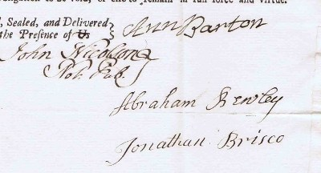
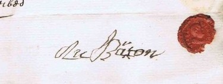
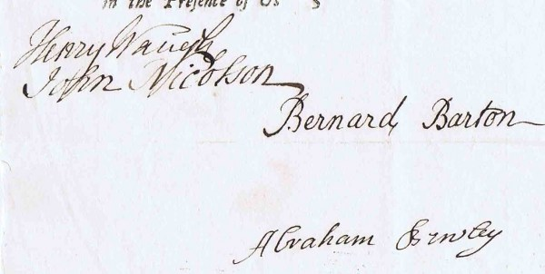

- [DBHB](Living%20connections.md#David Barton)'s great x6 grandmother.
- Married [John Barton of Ivegill (d.1747)](John%20Barton%20of%20Ivegill%20%28d.1747%29.md)
- Lived in [Ivegill](Ivegill.md) and/or [Thomas Close](Bartons%20Farm%2C%20Thomas%20Close.md), Cumbria.
- Mother of [Bernard Barton of Carlisle (1728-1773)](Bernard%20Barton%20of%20Carlisle%20%281728-1773%29.md)?

Ann's signature is on the 1747 probate of her [husband](John%20Barton%20of%20Ivegill%20%28d.1747%29.md)'s will:\
\
(Extract from a scan provided by the [\*Cumbria archive service](_Cumbria%20archive%20service.md))

# Birth

Paul Tucker suggests that Ann may have been born a Simpson, based on the fact that Robert Simpson and Lancelot Simpson are both witnesses to her will (below). The name recurs a lot in the area. The [1682 plaque on Highhead Chapel](High%20Head%20Chapel.md) mentions a Rowland Simpson, who also signs the related document (alongside a John Barton and a Bernard Barton). The 1737 will of [Isabell Miller of Highhead Castle](_Jackson%201892.md#pp130-143) lists as tenants Elizabeth, George, Rowland, John *and* Christopher Simpson! They were clearly a populous family in the area!

# Children

Ann's will (below) mentions three daughters (Margaret, Jane and Mabel), eldest son Bernard and youngest son John. John and Mabel are younger than 21 in 1748, meaning they were born after 1728.\
This matches names recorded in the [High Head chapel baptismal register](_High%20Head%20baptismal%20register.md) (and certain [online parish records](_Miscellaneous%20records.md#children of John Barton d.1747): Indexing Project (Batch) Number I03796-7 System Origin England-EASy Source Film Number 1472080) of children born in Ivegill to a father called [John](John%20Barton%20of%20Ivegill%20%28d.1747%29.md), which give the following dates:

1. [Margaret Barton](Margaret%20Barton%20%28b.1722%29.md), bpt. 10 Oct 1722, Ivegill
2. [Jane Barton](Jane%20Barton%20%28b.1725%29.md), bpt. 1 Aug 1725, Ivegill
3. [Barnard Barton](Bernard%20Barton%20of%20Carlisle%20%281728-1773%29.md), bpt. 23 Jun 1728, Ivegill
4. [Mabel Barton](Mabel%20Barton%20%28b.1732%29.md), bpt. 10 Sep 1732, Ivegill
5. John Barton, bpt. 18 Feb 1735, Ivegill (presumably died in infancy)
6. [John Barton](John%20Barton%20%28b.1737%29.md), bpt. 8 Mar 1737, Ivegill

# Burial

The [\*Dalston parish records](_Dalston%20parish%20records.md) include this entry (v2 p256):\
"*1748 March 14 Ann Barton of Hivegill widow buried*"

# Will

Ann Barton's own will is available from the [\*Cumbria archive service](_Cumbria%20archive%20service.md).

"*In the Name of God, Amen. I **Anne Barton** of Hive-gill in* *the Parish of Dalston and County of Cumberland Widow; being Infirm in* *Body, but of sound & perfect Mind & Memory (Blessed be Almighty God for* *the same) Do make and publish this my Last Will & Testament, in manner* *and Form following (that is to say) - - - - - -*\
*First, I Give, Devise & Bequeath all that my Messuage & Tenement together with* *all other my freehold Dales, & parcels of arrable Land, Meadows & Pasture Ground,* *Woods Houses, Hedges & every of their appurtenances situat & Lying & being at* ***[Thomas-close](Bartons%20Farm%2C%20Thomas%20Close.md)** in the Parish of Hutton & County aforesaid, with the Reversion and* *Reversions, Remainder & Remainders Rents Issues & profits thereof, & every part &* *parcel thereof; unto my younger son & three daughters, **John Barton**, **Margaret*** ***Barton**, **Jane Barton** & **Mabel Barton** To Hold to them their & every of their* *Heirs and assigns for ever. Provided always & upon this condition that if* *my **Eldest Son Bernard Barton** his Heirs, Executors, Administrators or assigns* *do pay or cause to be paid unto my younger son John Barton or his Heirs the sum* *of Forty pounds of lawful British money when he shall arrive at the age of* *twenty-one. And also unto my Daughter Margaret Barton, or her Heirs the sum* *of Twenty Pounds of Lawful British money twelve months after my decease. And* *unto my Daughter Jane Barton or her Heirs the sum of twenty pounds of lawful* *British money twelve months after my decease. And also unto my Daughter* *Mabel Barton or her Heirs the sum of twenty pounds of lawful British money* *when she shall arrive at the age of twenty one. And in case I Live* *until my two youngest Children attain the age of twenty one; then my Will &* *desire is that the sums above devised unto them shall become due & payable twelve* *months after my Decease. That Then & after the full payment of all & every the* *respective sums above mentioned. My Will & desire is that all the above Devised Free-**hold Lands & Houses with the appurtenances thereunto belonging lying at Thomas Close* *aforesaid shall be & remain unto my Eldest Son Bernard Barton his Heirs & assigns for ever.*

*Also, I give and bequeath unto my three Daughters Margaret, Jane and* *Mabel all my Household stuff of what kind or denomination soever, to be* *equally divided amongst them at my decease.* *And Lastly, as to the rest & residue of my personal Estate, Goods & Chattels of what* *kind or Nature soever (after the discharge of my Debts Legacies & Funeral* *expenses) I give & bequeath the same to my Eldest Son Bernard Barton whom* *I appoint my sole Executor of this my Last Will & Testament; hereby Revoking* *all former Wills by me made. In Wittness whereof I have hereunto set my Hand* *& Seal the twenty-fourth Day of January in the twenty second year of the Reign of* *our Sovereign Lord George the second, & in the year of our Lord 1748.*

*Signed, Sealed, published & declared by the above* *named Anne Barton to be Her Last Will & Testament* *in the presence of us, who have hereunto subscribed* *our names in the presence of the Testatrix.*

*Abraham Bewley*\
*Robert Simpson*\
*Lancelot Simpson*

*[signed by] Ann Barton*"

\
(Extract from a scan provided by the [\*Cumbria archive service](_Cumbria%20archive%20service.md))

Thomas Close is a small village about 2 miles SSE of Ivegill, at which there is to this day a "[Bartons Farm](Bartons%20Farm%2C%20Thomas%20Close.md)".

Her son [Bernard Barton of Carlisle (1728-1773)](Bernard%20Barton%20of%20Carlisle%20%281728-1773%29.md) signs the 1749 probate of this will:\
\
(Extract from a scan provided by the [\*Cumbria archive service](_Cumbria%20archive%20service.md))
