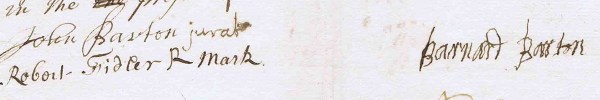
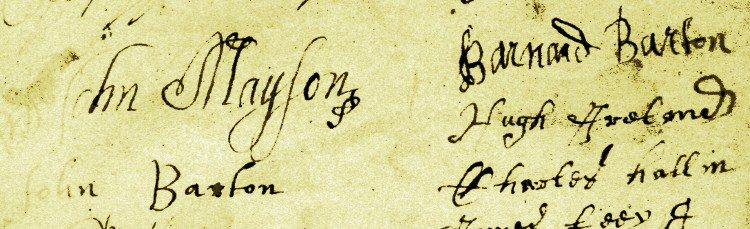

- Signed his name 'Barnard'
- Married to 'Maball'.
- Possibly the brother of [John Barton (d.1720)](John%20Barton%20%28d.1720%29.md).
- Member of the committee that restored nearby [High Head chapel](High%20Head%20Chapel.md) in ~1682.

# Birth

No record of Barnard's birth has yet been found, but based on the ages of his children (below) he was likely born between about 1650 and 1667. Therefore it quite feasible that he was the brother of [John Barton (d.1720)](John%20Barton%20%28d.1720%29.md) who seems to have been born between about 1662 and 1673.

# Children

According to the will below, Barnard and Maball had four children: John, Margaret, Bernard and Jane.

The [\*Dalston parish records](_Dalston%20parish%20records.md) v2, p10 and p14 contain the following baptism entries which may refer to the daughters:\
*1689: Decr 8 Margaret of Barnard Barton de Ivegill*\
*1695: ffeby 6 Jane of Barnard Barton de Ive Gill*\
(The same records are [online](_Miscellaneous%20records.md#children of barnard barton d.1715): Indexing Project (Batch) Number P00196-1 System Origin England-ODM Source Film Number 162087 - however these give the birth year of Jane as 1696, which may be more accurate, having corrected for the fact that ecclesiastical records of this period began the new year at March 25)

The will below, which in all likelihood lists his children in chronological order, therefore suggests that Barnard's son John was born between about 1685 and 1689 (therefore very unlikely to be [John Barton d.1720](John%20Barton%20%28d.1720%29.md)), and his son Bernard between 1689 and 1695.

Although he would therefore have been quite young (between 18 and 24 in 1713), Barnard's son Bernard *may* be the one mentioned in [\*Transactions CWAAS v5 1905 p96](_Transactions%20CWAAS%20v5%201905.md#96): "*In 1713, Bernard Barton was licensed as reader and schoolmaster, and in 1715 Bernard Barton, of Ivegill, was ordained deacon; no fresh license was issued to him.*"\
It might also be the same man whose marriage is recorded in the Sebergham parish registers: "*1709 Aug.7. Bern Barton and ........ Stanwick, M.*" (see [\*Transactions CWAAS v9 1888 p68](_Transactions%20CWAAS%20v9%201888.md#68))

# Burial record

The [\*Dalston parish records](_Dalston%20parish%20records.md) include this entry (v2 p237):\
"*1715 Novemb 14 Barnard Barton of Hivegill buried*"

# Will and testament

Barnard Barton's will is available from the [\*Cumbria archive service](_Cumbria%20archive%20service.md):

"*In the name of God, Amen. The 22 day of October A:D:1715* *I Bernard Barton, being Sick and Weak in Body, but of perfect* *Mind & Memory (thanks be to God therefore) do Ordain this my last* *Will & Testament; First of all I recommend my Soul into the hands* *of God that gave it, & for my Body, I commend it to the Earth* *to be Buried in a Christian-like & decent manner in Dalston Church* *yard, and as touching my Worldly Estate wherewith it hath pleased God* *to bless me, I give & despose of it in this Will following.*\
*Imprimus. I give unto my Son John Barton the sum of* *Ten shillings.*\
*Secondly I give unto my Daughter Margaret the Sum* *of ten shillings.*\
*Thirdly I give unto my Son Bernard Barton the Sum* *of ten shillings.*\
*Fourthly I give unto my Daughter Jane Barton the Sum* *of ten shillings.*\
*And all the rest of my Goods Moveable & Immoveable I* *give unto Maball Barton my wife whom I appoint sole* *executor of this my last Will & Testament; (discharging* *all debts & funeral expences), Revokeing all other Wills &* *Testaments whatsoever, making this only my Last Will.*\
*In Witness whereof I have hereunto set my hand* *the day and year above written.*\
*Signed and Subscribed* *in the presence of*\
*John Barton jurat*\
*Robert Fidler R Mark*\
*[signed by] Barnard Barton*"

\
(Extract from a scan provided by the [\*Cumbria archive service](_Cumbria%20archive%20service.md))

Bernard's signature is certainly a match to one on a 1682 document relating to the restoration of [High Head chapel](High%20Head%20Chapel.md):\
\
The adjacent signature of John Barton, however, bears no obvious relation to that of Bernard's son above, who may or may not be [John Barton (d.1720)](John%20Barton%20%28d.1720%29.md).
