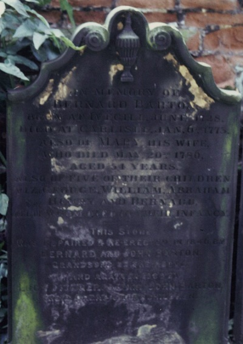

- [DBHB](Living%20connections.md#David Barton)'s great x5 grandfather.
- Born June 1728, son of [John Barton of Ivegill (d.1747)](John%20Barton%20of%20Ivegill%20%28d.1747%29.md) and [Ann (d.1748)](Ann%20%28d.1748%29.md).
- Contemporary of [Captain James Cook (1728-1779)](http://en.wikipedia.org/wiki/James_Cook).
- Moved from [Ivegill](Ivegill.md) to Carlisle in 1761.
- Married, in 1754, [Mary Porter (1732-1786)](Mary%20Porter%20%281732-1786%29.md).
- Inventor of the 'horizontal flax wheel', a multi-user [spinning machine](http://en.wikipedia.org/wiki/Spinning_frame).
- Father of [John Barton the Elder (1754-1789)](John%20Barton%20the%20Elder%20%281754-1789%29.md).
- Died 6 January 1773/4, aged 44 or 45.

\
Bernard Barton invented a 'horizontal flax wheel' (replica above), allowing up to 12 people to spin flax yarn from a single centrally powered wheel. Less physically demanding to operate than an ordinary spinning wheel, it helped children to learn the craft of spinning, as well as creating employment for them or for the infirm. Bernard's grandson, [Bernard Barton the Quaker poet (1784-1849)](Bernard%20Barton%20the%20Quaker%20poet%20%281784-1849%29.md) claimed in a letter (printed in [\*Fitzgerald 1849 p213](_Fitzgerald%201849.md#212-216) and [\*Barton 1850 p14](_Barton%201850.md)) that the inventor was awarded "*a medal from the Royal Society? - so says Pennant.*" but this is dubious for several reasons. For a start [Pennant](_Pennant%201774%20%26%201776.md), though he does describe the wheel, makes no mention of a medal. Secondly, it was not the [Royal Society of London for the Improvement of Natural Knowledge](http://en.wikipedia.org/wiki/Royal_Society) (the organization usually referred to as 'the Royal Society'), but the [Royal Society for the encouragement of Arts, Manufactures and Commerce](http://en.wikipedia.org/wiki/Royal_Society_for_the_encouragement_of_Arts,_Manufactures_&_Commerce) (which at that time had not yet been granted the 'Royal' prefix), and the device came to their attention through a [letter](_John%20Barton%20the%20Elder%20Correspondence.md) written by Bernard's son [John](John%20Barton%20the%20Elder%20%281754-1789%29.md) 20 years after Bernard's death. Although, as a consequence, the wheel received a brief mention in the [Transactions](_Transactions%20SEAMC%20v6%201788.md) of the latter society, there does not seem to be any evidence of a medal being awarded posthumously. (The error is repeated and amplified in [\*Smith 1878 p241](_Smith%201878.md#241-245), which says it was a 'gold medal'). A good overview of what little is known of Bernard's life, business and invention can be found in [\*Humphries 1984](_Humphries%201984.md).

# Birth

Bernard's baptism is recorded in the [baptismal register of High Head Chapel](_High%20Head%20baptismal%20register.md), and the record can also be [found online](_Miscellaneous%20records.md#children of John Barton d.1747) (Indexing Project (Batch) Number I03796-7 System Origin England-EASy Source Film Number 1472080). The register gives his father's name as 'John', his birthplace as 'Ivegill' and his baptism date as 23 June 1728.\
This matches details given on his gravestone (below): "*Bernard Barton, born at Ivegill June 1728*", although it seems these details were added later in 1888.\
The same [register](_High%20Head%20baptismal%20register.md) and [online records](_Miscellaneous%20records.md#children of John Barton d.1747) contain baptism notices for Margaret Barton (b.1722), Jane Barton (b.1726), Mabel Barton (b.1732), John Barton (b.1735) and John Barton (b.1737), all born in Ivegill to a father named John. This perfectly matches the children mentioned in the will of [Ann (d.1748)](Ann%20%28d.1748%29.md), wife of [John Barton of Ivegill (d.1747)](John%20Barton%20of%20Ivegill%20%28d.1747%29.md), thus leaving very little doubt that he is the Bernard mentioned in that will, whose signature is shown below.

# Signature

This is believed to be Bernard's signature, on the probate of his [mother's will](Ann%20%28d.1748%29.md):\
\
(Extract from a scan provided by the [\*Cumbria archive service](_Cumbria%20archive%20service.md))

Bernard would have been only 19-20 years old when his parents died (and his son [John](John%20Barton%20the%20Elder%20%281754-1789%29.md) was about the same age when Bernard died).

# Manorial Documents

Two manorial documents, found amongst the [\*ABH research notes](_ABH%20research%20notes.md), relate to Ivegill and possibly to Ive Bank. The first is believed to describe the handing over of the property rights to Bernard from his father, the recently deceased [John Barton of Ivegill (d.1747)](John%20Barton%20of%20Ivegill%20%28d.1747%29.md):

 .jpg")

"*9 Dec. 1747*

*Manor of Highhed.*

*On the Ninth day of December in this Year of Our Lord One Thousand, Seven Hundred & Forty Seven Came **Bernard Barton**, upon the Death of **John Barton**, Father of ye sd. Bernard Barton, & took of me Susannah Richmond Lady of the said Mannor, a [Messuage](http://en.wikipedia.org/wiki/Messuage) & [Tenemt](http://en.wikipedia.org/wiki/Tenement_(law)). wth. the [appurtenances](http://en.wikipedia.org/wiki/Appurtenance) lying at [Ivegill](Ivegill.md) wth.in, & parcell of the said Manor, of the Yearly Arbitrary Customary Rent of Eight Shillings & Sixpence, & other Services, To Hold the said Messuages & Tenemt. wth. the appurtenances unto the said Bernard Barton during the Joint Lives of me the said Lady & the said Bernard Barton at the will of the Lady according to the Custom of the said Manor. Yielding & Paying therefore the sd.* *Yearly Rent of Eight Shillings & Sixpence at the days & times due & of right accustom'd. And doing, paying, & performing, all other Dues, Duties, Customs & Service, due for & in respect of the Same & the said Bernard Barton having compounded for & paid the Sum of Five Pounds & Nineteen Shillings as the Descent Fine, is thereupon admitted Tenant by me,*

*Sus. Richmond.*

*Rent*\
*L S D*\
*0:8:6*

*Admittance*\
*0:2:6*\
*Enrolling*\
*0-1-0*

*Fine*\
*£5-19-0*

*A Godspenny*"

The second document, of which only a transcript is in my possession, then repeats the process for Bernard's son, [John Barton the Elder (1754-1789)](John%20Barton%20the%20Elder%20%281754-1789%29.md) (Bernard having died on 6 Jan 1773):

"*1 Jan 1774*

*Manor of Highead.*

*Be it remembered on the first Day of January in the Year of Our Lord One Thousand Seven Hundred and Seventy Four came **John Barton** Son and Heir of **Bernard Barton** deceased and took of me Susannah Richmond Lady of the said Manor a Messuage and Teniment with the Appurtenances lying and being at Ivegill within and parcel of said Manor a Messuage and Teniment of the Yearly customary Rent of Eight Shillings and Sixpence and other Services to Hold the said Messuage and Tenim.t with the appurtenances unto the said John Barton at the Will of the Lady According to the Customs of the sd. Manor. Yeilding and paying therefore the said yearly rent of Eight Shillings and Sixpence at the Days and Times due and of right accustomed and doing paying and for the same And the said John Barton having Compounded and paid the Sum of Six pounds Six Shillings for & as a Desent Fee is therefore admitted Tenant.*

*By Me*

*her*\
*Sus R Richmond"*\
*mark*

*Rent*\
*L S D*\
*0:8:6*

*Admittance*\
*0:2:6*\
*Enrolling*\
*0-1-0*

*Fine*\
*L S D*\
*6:6:6*\
*A Godspenny*"

N.B. This same annual rent, of 8 shillings and 6 pence, is recorded as the rent to another tenant named John Barton in the [1736 will of Isabella Miller of Highhead Castle](_Jackson%201892.md#pp130-143). Presumably [Bernard's father](John%20Barton%20of%20Ivegill%20%28d.1747%29.md)?

# Marriage

From the registers of the parish of Westward:

*1754. [Bernard Barton](Bernard%20Barton%20of%20Carlisle%20%281728-1773%29.md) & Mary Porter from the parish of Dalston Jany 13 (married).*" ([\*Transactions CWAAS v13 1895 p117](_Transactions%20CWAAS%20v13%201895.md))

This suggests that Mary Porter was from somewhere in the [Westward parish](Parishes%20of%20Cumberland%20and%20Westmorland.md)

# Children

Bernard's gravestone (below) includes the names of five of his children who died in infancy: "*George, William, Abraham, Henry and Bernard*".

[Robert Barton's book](_Barton%201980s.md) names those and lists five more: [John Barton the Elder (1754-1789)](John%20Barton%20the%20Elder%20%281754-1789%29.md), [Margaret Barton (1755-1836)](Margaret%20Barton%20%281755-1836%29.md), [Joseph Barton (b.1760)](Joseph%20Barton%20%28b.1760%29.md), Jane Barton (b.1763) and [Isaac Barton (1771-1819)](Isaac%20Barton%20%281771-1819%29.md).

The following [online parish records](_Miscellaneous%20records.md#children of John Barton d.1747) have been found (Indexing Project (Batch) Number I03796-7 System Origin England-EASy Source Film Number 1472080, and Indexing Project (Batch) Number C05598-1 System Origin England-ODM Source Film Number 90578) which support this:

1. George Barton, b./bpt. 6 Apr 1753, Ivegill (presumably died in infancy)
2. [John Barton](John%20Barton%20the%20Elder%20%281754-1789%29.md), b./bpt. 17 Sep 1754, Ivegill
3. [Margret Barton](Margaret%20Barton%20%281755-1836%29.md), b./bpt. 30 Oct 1755, Ivegill
4. George Barton, b./bpt. 2 Apr 1758, Ivegill (thought to have died young; see gravestone below)
5. [Joseph Barton](Joseph%20Barton%20%28b.1760%29.md), b./bpt. 29 Jul 1760 / 31 Jul 1760, Ivegill
6. Jane Barton, b./bpt. 14 Aug 1763, St. Cuthbert, Carlisle
7. William Barton, b./bpt. 14 Sep 1764, St. Cuthbert, Carlisle (died 20 Nov 1764)
8. Abraham Barton, b./bpt. 11 May 1766, St. Cuthbert, Carlisle (died 3 Jun 1766)
9. Harry Barton, b./bpt. 25 Feb 1768, St Cuthbert, Carlisle (died 29 Feb 1768)
10. Bernard Barton, b./bpt. 29 Jan 1769, St Cuthbert, Carlisle (thought to have died young; see gravestone below)
11. [Isaac Barton](Isaac%20Barton%20%281771-1819%29.md), b./bpt. 7 Jan 1771, St Cuthbert, Carlisle

These records support the assertion in [\*Humphries 1984](_Humphries%201984.md) that Bernard Barton moved from Ivegill to Carlisle in 1761 (7 years into his marriage, when he was 33 years old).

# Writing

A letter written by Bernard to his son [John](John%20Barton%20the%20Elder%20%281754-1789%29.md)'s schoolmaster Mr. Lowthion (whose school was in Newcastle) is the only piece of his personal correspondence that we currently know of (see [here](_John%20Barton%20the%20Elder%20Correspondence.md#bernard-barton-to-mr-lowthion-january-1772)):

*Carlisle 21st Jany. 1772*

*Kind Sir,*

*I recd. your [agreeable card](_John%20Barton%20the%20Elder%20Correspondence.md#mr-lowthion-to-bernard-barton-january-1772) of Jany. 16th & can assure you I can better feel than express the pleasure you give me by the Acct. of My Son's conduct. May kind Providence Grant him resolutions to persevere in well doing, Indeed I cannot have the least apprehension of the reverse while he is in his present situation. He has Acquir's Such a respect for Mr. Lowthion that I dare say it would make him quite unhappy if he was Guilty of an Action that would the least displease him, How happy would it be for the rising Generation could as Good an Understanding be Acquired between every Master and his Pupil, when it is ye Contrary as is too often the case what progress can be expected in their Intended Studies.*

*I am happy in the good fortune of having a Son placed under your care where Morals as well as Science is some part of his study, a Pathron[?] too much neglected in most part of our schools and am well assur'd that nothing will be wanting on your part towards the imploying his time to the best advanatage.*

*I am Dr. Sir with the greatest respect Yr. Most Obliged Able Ser.*

*B.B.*

# Will

Photocopies of Bernard's 1773/4 will are in [\*ABH research notes](_ABH%20research%20notes.md):\

*In the name of God amen I Bernard Barton of the City of Carlisle in the County of Cumberland Manufacturer being sick and Weak in Body but of sound and perfect disproving Mind, Memory, and Understanding, Do make this my last Will and Testament in Manner and Form following that is to say. First it is my will and order that all such just Debts as I shall owe at the time of my Decease, shall be paid and satisfied and whereas the principle part of my personal Estate is now in Trade, and therefore subject to many Carnathis[?], I do hereby nominate, constitute and appoint Isaac Robson of Grap Garth, William Halton, and Thomas Hodgson Weaver of Carlisle my Sole Executors, & Trustees of this my last Will and Testament with full power to sell and dispose of my real and personal Estate for the Discharge of my just Debts, and for the Maintenance & support of my dear Wife and Children. And I will and order that my Son [John](John%20Barton%20the%20Elder%20%281754-1789%29.md) shall act in Conjunction with my said trustees in adjusting and settling my affairs, and in prosecuting my Business of Manufacturing and Bleaching if it shall be thought Necessary, by my Trustees for the advantages of my Family. And if after discharging all my just Debts, any part of my Estate shall remain, I leave it to the Choice of my said Son John, whether he reserve my Messuage or Tenament at [Hivegill](Ivegill.md) or my Houses, Shops & Gardens at Carlisle, and whatever more shall remain, besides one of the above mentioned Tenements it shall be divided amongst my dear Wife and Children in such proportion as my aforesaid Executors & Trustees shall think proper. And it is my will and Desire that my said Executors and Trustees shall not be charged or accountable for any Loss that shall happen in the Management or Disposal of my Estate in Effects, they respectively acting bona fide and according to the best of their Discretion. And I will and order that my said Executors shall have a reasonable satisfaction for their trouble and be reimbursed any reasonable Charges that may be incurred in the Execution of this my last will and Testament. And lastly revoking all former Wills, by me at any time heretofore made I declare this to be my last Will and Testament. In Witness whereof thereunto set my hand and Seal this 2d. Day of January in the year of our Lord 1773. Bernard Barton \**

*Signed, sealed, published & declared by the said Testator as and for his last will and Testament in the presence of us, who, in his presence and at his request have hereunto subscribed our Names as Witnesses.*

*Arch.d. Kirkpatrick sworn W. Halton sworn John Jefferson Sworn.*\
*Proved March 5th 1773.*"

He died 4 days after completing this will.

Note that the actual year of this will and of Bernard's death may in fact have been 1774 by modern reckoning, since some places were slower than others in adopting the Gregorian calendar in which the new year began on 1 January (rather than 25 March as was traditional until - in most places - 1752). This might explain why Bernard's age at his death, according to his gravestone, was 45, rather than 44.

# Gravestone

Bernard is buried in the churchyard of [St Cuthbert's Church](http://www.stcuthbertscarlisle.org.uk/) in Carlisle:

[[Embedded Bing map]](http://www.bing.com/maps/embed/?lvl=17&cp=54.893449999999994~-2.937413888888898&sty=h&draggable=true&v=2&eo=1&where1=54.89345%2C+-2.93741388888889&pp=54.89345~-2.93741388888889&emid=9d2e93af-5b71-64a8-fc7d-180c2b5a757b&w=800&h=300)

[View Larger Map](http://www.bing.com/maps/?mm_embed=map&cp=54.893449999999994~-2.937413888888898&lvl=17&sty=h&where1=54.89345%2C+-2.93741388888889) [Get Directions](http://www.bing.com/maps/?mm_embed=dir&cp=54.893449999999994~-2.937413888888898&rtp=~pos.54.89345_-2.93741388888889_54.89345%2C+-2.93741388888889&lvl=17&sty=h) [View Bird's Eye](http://www.bing.com/maps/?mm_embed=be&cp=54.893449999999994~-2.937413888888898&lvl=1&sty=b&where1=54.89345%2C+-2.93741388888889)

The original headstone inscription is reproduced in an [1846 letter](_Bernard%20Barton%20the%20Quaker%20Poet%20Correspondence.md#bernard-barton-to-rev-george-crabbe-august-1846-p139) by his grandson [Bernard Barton the Quaker poet (1784-1849)](Bernard%20Barton%20the%20Quaker%20poet%20%281784-1849%29.md) to Rev. George Crabbe (see also [\*Barton 1850](_Barton%201850.md), pp141-143):

*"Erected in memory of Bernard Barton; who died Jan. 6th, 1773; aged 45 years; also of Mary, his wife; who died May 20th, 1786, aged 54 years; also of five of their children; viz: George, William, Abraham, Henry, and Bernard; who died in their infancy."*

By 1846, the headstone was worn and had all but fallen over. Bernard and his brother paid to have it fixed, and in the same letter went on to describe the additional lines he and his brother intended to have added:

"*Repaired and erected 1846, by Bernard and John Barton, Grandsons of the first-named deceased.*"

The inscription, with addition, is later described, in [\*Transactions CWAAS v7 1884 p172](_Transactions%20CWAAS%20v7%201884.md#171-172) (apparently with a few errors) as follows:

*"In memory of B<u>a</u>rnard Barton who died January 6th, 1773, aged 45 years; also of Mary his wife, who died May 20th, 1786, aged <u>56</u> years; also of five of their children, viz: George, William, Abraham, Henry, and <u>Barnard</u>, who died in their infancy. Repaired and <u>re-</u>erected by Bernard and John Barton, grandsons of the first named deceased, <u>1840</u>.*"

However in 1888 the entire headstone was completely **replaced** by [Lucy Fitzgerald nee Barton (1808-1903)](Lucy%20Barton%20%281808-1903%29.md) and her first cousin [Rev. John Barton of Cambridge (1836-1908)](Rev.%20John%20Barton%20of%20Cambridge%20%281836-1908%29.md). The new inscription read:

"*In memory of Bernard Barton, born at Ivegill June 1728. Died at Carlisle Jan. 6. 1773. Also of [Mary his wife](Mary%20Porter%20%281732-1786%29.md), who died May 20th 1786, aged 54 years. Also of five of their children, viz. George, William, Abraham, Henry and Bernard, all of whom died in their infancy. This stone was repaired and re-erected in 1846 by [Bernard](Bernard%20Barton%20the%20Quaker%20poet%20%281784-1849%29.md) and [John Barton](John%20Barton%20Senior%20%281789-1852%29.md), grandsons of the above: and again in 1888 by [Lucy Fitzgerald](Lucy%20Barton%20%281808-1903%29.md) and [John Barton](Rev.%20John%20Barton%20of%20Cambridge%20%281836-1908%29.md), their great grandchildren*."

Therefore the date (June 1728) and place of birth (Ivegill) of Bernard Barton are later interpolations, rather than primary sources.

BELOW LEFT: the replacement headstone, brand new in 1888, with corrections marked on by [Rev. John Barton](Rev.%20John%20Barton%20of%20Cambridge%20%281836-1908%29.md). On the reverse of the original is a fragment of letter from "J. & W. Baty, Builders and Contractors, Upperby & Carlisle", addressed to "Rev. J. Barton, [Trinity Vicarage](Holy%20Trinity%20Church%2C%20Cambridge.md#Vicarage), Cambridge" and dated Carlisle Jan 15th 1889. The body of the letter begins: "Dear Sir, re: Headstone. Having mislaid your letter .. of instructions we are unable to make..."

BELOW RIGHT: the replacement headstone as it looked in 2009. It would appear that John's corrections were made! Photo courtesy of [Malcolm Barton](Living%20connections.md#Malcolm Barton).

