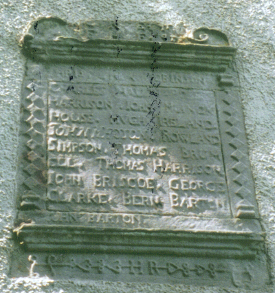
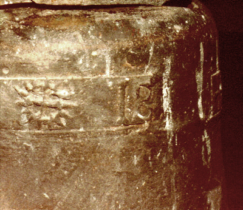
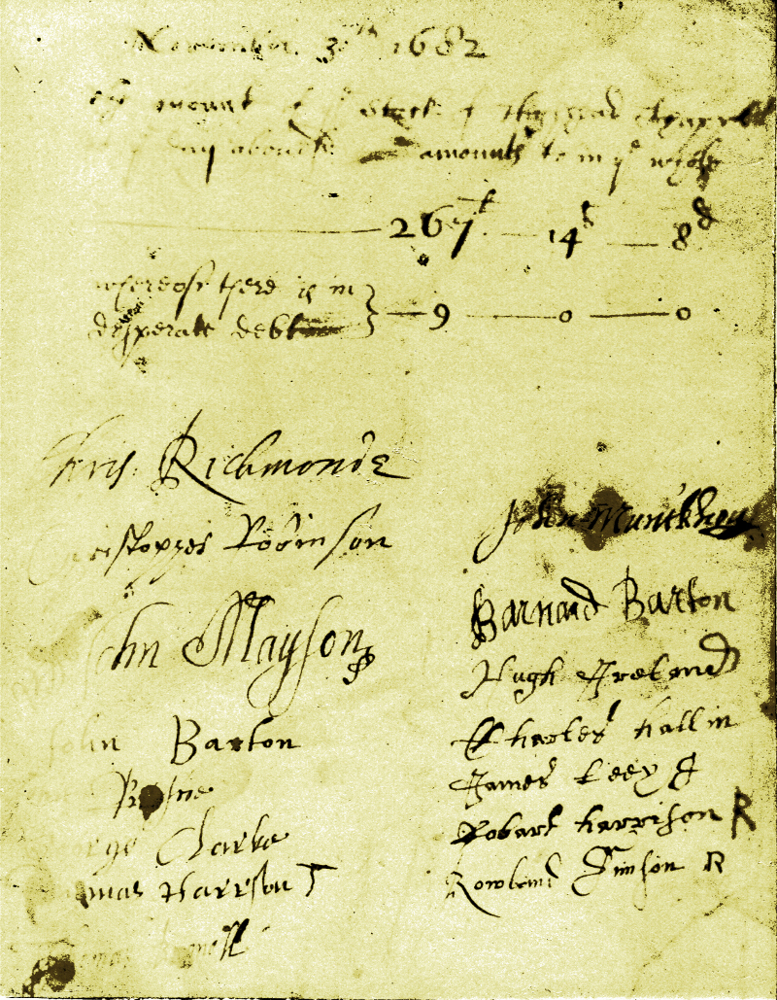

[[Embedded Google map]](https://maps.google.co.uk/maps?q=54.783807,-2.927744&num=1&t=h&sll=54.780699,-2.906449&sspn=0.051496,0.128059&gl=uk&ie=UTF8&ll=54.783786,-2.927728&spn=0.00735,0.034289&z=15&output=embed)

[View Larger Map](https://maps.google.co.uk/maps?q=54.783807,-2.927744&num=1&t=h&sll=54.780699,-2.906449&sspn=0.051496,0.128059&gl=uk&ie=UTF8&ll=54.783786,-2.927728&spn=0.00735,0.034289&z=15&source=embed)

High Head chapel, now a private house, was a chapel in the grounds of the now-ruined [High Head Castle](http://en.wikipedia.org/wiki/High_Head_Castle). The chapel is about a mile west of [Ivegill](Ivegill.md), and members of the Barton family evidently contributed to its restoration.

"*<u>Highead, or Ivegill</u>*\
*HIGHEAD, or Ivegill, a chapelry, in the parish of Dalston, union of Carlisle, ward, and E. division of the county, of Cumberland, 4 miles (S. by W.) from Dalston; containing 124 inhabitants. The living is a perpetual curacy; net income, £80: patrons, twelve Trustees; appropriator, the Bishop of Carlisle. The chapel, a mean building devoid of ornament, was erected by William L'Englise, and once belonged to the lords of the manor: near it, situated on the brow of a rocky eminence, are the gateway-tower, a turret, and other remains of Highead Castle, the ancient residence of the Richmond family, now a farmhouse." [\*Lewis 1848](_Lewis%201848.md#505-509)*

"*The chapel of ease here has more the appearance of a tithe barn than a place of worship, being a long narrow building, without wiling or ornament. It was erected by William son of William L'Englise, and stands near to the castle. It has twice received [Queen Anne’s bounty](http://en.wikipedia.org/wiki/Queen_Anne's_Bounty), with which land was purchased near Keswick and Hesket-New-Market. In Hutchinson's time (1795) it had a "stock or endowment of £300 secured in the hands of John Gate, Esq. of Whitehaven, as executor of Henry Richmond Brougham, Esq. at £5 per cent." The whole income was then £30 a year, including a small stipend paid annually from the castle. The Rev. Hugh Elliot of Sebergham, is the incumbent curate.*" [\*The Citizen (Carlisle periodical) #21 March 1 1830](_The%20Citizen%20%28Carlisle%20periodical%29.md#632-633). See also [\*Mannix & Whellan 1847](_Mannix%20%26%20Whellan%201847.md).

"*The chapel, until 1868 a chapel of ease to Dalston, was originally built in 1358 (Hutchinson, II, 427; B. & N., II, 321). The county historians, however, omit to mention that it was rebuilt in 1682, as is indicated by an inscription over the door:*\
*CHRISTOPHER RICHMOND ESQ*\
*EDWARD HASELL ESQ*\
*ANNO DOMINI 1682.*" ....\
*"Whellan (p. i66), correctly describing the chapel as “a plain and somewhat mean-looking building”, incorrectly says it was “erected in 1836 upon the site of an older building”. The present vicar of Ivegill and Highhead, Canon Phillips, says it was “not rebuilt but only restored in 1836”, and that old inhabitants remember it as having before that time “an open roof, and seats facing one another”.* [\*Transactions v9 1888 pp246-247](_Transactions%20CWAAS%20v9%201888.md#246-248)

\
**The plaque**\
\
(Photo courtesy of Malcolm Barton)

*"A tablet on the outside of the east wall has an undated inscription, but evidently belonging to the same time as that over the door :*\
*C R ESQ E H ESQ* [1]\
*CHRISTOPHER ROBINSON CHARLES HALIN* [2] *ROBERT*\
*HARRISON JOHN MONCKHOUSE HUGH IRELAND*\
*JOHN MAYSON ROWLAND SIMPSON THOMAS*\
*BRUMELL THOMAS HARRISON JOHN BRISCOE*\
*GEORGE CLARKE **BERN : BARTON*** [3] ***JOHN BARTON*** [4]\
*H R.*" [\*Transactions v9 1888 pp246-247](_Transactions%20CWAAS%20v9%201888.md#246-248)

1. i.e. CHRISTOPHER RICHMOND ESQ EDWARD HASELL ESQ as on the door inscription described above. The Richmonds were the owners of [High Head Castle](http://en.wikipedia.org/wiki/High_Head_Castle) at this time.
2. Based on the document below, this may be misread and should probably be Hall, not Halin.
3. 'BERN : BARTON' is almost certainly [Bernard Barton (d.1715)](Bernard%20Barton%20%28d.1715%29.md) since a signature on a document relating to the restoration (see below) matches the signature on his will.
4. The exact identity of John Barton (whose name is on the lower margin of the plaque as if an afterthought) is more difficult to establish with certainty because the name is repeated across multiple generations, but may very well be [John Barton (d.1720)](John%20Barton%20%28d.1720%29.md).

# The bell

*"The bell, hung in a cot on the west gable, is 14¾ inches in diameter, weight about 90lbs, and bears this inscription:*\
*1635 + AD **U** IB +* ST\
*The date is preceded by incised marks of “herring-bone” character. The cross is a cross-moline. The stamp between A D and I B is a circle inclosing a cross, and surrounded by projecting lines apparently representing the rays of the sun. The letters A D and I B are plain Lombardic. A D may be intended for anno domini. I B, from what is known of the inhabitants about that time, may stand for John Briscoe, **John Barton**, or John Bewley. S T, Roman capitals, and larger than the other letters, may be the initials of the bell-founder. Two letters, IW, roughly incised on the crown, may be the initials of some one who at a later period supplied the cast-iron headstock which is rivetted to the crown without canons.*" [\*Transactions v9 1888 pp247-248](_Transactions%20CWAAS%20v9%201888.md#246-248).

The letters "IB" are just like those in the inscription above the door at [Ive Bank in Ivegill](Ive%20Bank%2C%20Ivegill.md), and thus might refer to [John Barton (d.1720)](John%20Barton%20%28d.1720%29.md).

# The document

\
A document dated 1682 and relating to the restoration of High Head chapel contains the signatures or marks of the men on the plaque (plus one more.. a James Leey?)

# The register

The preface to volume 2 of the [\*Dalston parish records](_Dalston%20parish%20records.md) contains the following footnote on p.iii:

*“It should be stated here that there is a Baptismal Register at High-head chapel, beginning in 1709, which probably contains all the baptisms for the township of [Ivegill](Ivegill.md) from that date and which has not been printed in these pages. All the marriages and burials for that division of the parish are recorded in the Dalston Register and on that account are included in the printed transcript. High-head Chapel was an ancient chapel of ease to Dalston, but was made a separate ecclesiastical district in 1867.”*

It contains a number of Bartons. See [\*High Head baptismal register](_High%20Head%20baptismal%20register.md).
