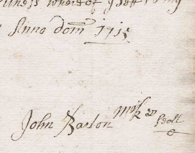
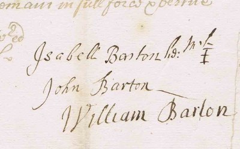
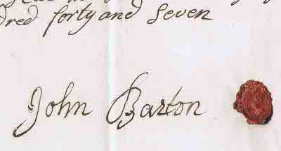

- [DBHB](Living%20connections.md#David Barton)'s great x7 grandfather?
- Maybe be descendant of [Sr Barnard Barton (d.1633)](Sr%20Barnard%20Barton%20%28d.1633%29.md) and [Mabell Robinson (1578-1639)](Mabell%20Robinson%20%281578-1639%29.md)? Possibly the brother of [Barnard Barton (d.1715)](Barnard%20Barton%20%28d.1715%29.md)?
- Lived in [Ivegill](Ivegill.md), and/or [Parcy Close](Parsy%20Close%2C%20near%20Thomas%20Close.md), Cumbria.
- Married Isabell, and it may be their initials (JB:IB) above the door of [Ive Bank, Ivegill](Ive%20Bank%2C%20Ivegill.md).
- Possibly involved with the committee that restored nearby [High Head chapel](High%20Head%20Chapel.md) in ~1682.
- Father of [William Barton (1700-1763)](William%20Barton%20%281700-1763%29.md)?
- Father of [John Barton of Ivegill (d.1747)](John%20Barton%20of%20Ivegill%20%28d.1747%29.md)?

# Birth

No record of John's birth has yet been found, but based on the ages of his children (below) he was likely born between about 1662 and 1673. The [Heskett register](_Heskett%20parish%20records.md) contains the following entry: "*John the sonn of John Barton bapts. the 7th day of May* [1676]", which might possibly be the same man.

# Will

John Barton's will is available from the [\*Cumbria archive service](_Cumbria%20archive%20service.md). It reads (as far as I can tell):

"*Praised be the Lord, I John Barton of Ivegill Head in the parish* *of [Heskett](http://en.wikipedia.org/wiki/Hesket,_Cumbria) am at this time perfect in memory but weak in body* *doe at this time make my last will and testament desiring* *to be in readyness when it shall please the Lord to call me and* *my worldly goods the Lord hath endowed me with as foloweth-*\
*Itam[Item]. I give and devise one cloase[?] of free hould lands known by* *the name of **parcy Close** with all its appurtinances unto* *my son John and to his heirs and asignes forever allwayes* *provided that if his Brother my Elder Son William doe satisfie* *and pay unto my said son John when he ataines the age of* *Twenty one years five pounds of Curand[Current] money of great Britain* *and five pounds other these years every year five pounds untill* *sums of twenty pounds be payed that then William my other* *son shall have and pearsably[?] enjoys the said Close or Closes* *caled **parce Close** be the said William his heires and asignes* *for ever.*\
*Itam[Item] and all the rest of my goods and Chatles moveable and -* *unmoveable I give and Bequeath unto Isabell my Loving* *wife and to John my said son which I doe by this my last will* *make my joynt executorice and executor and to pay my just* *debts and funeral expences - In Witness where of I Sett to my* *hand and seall this 6th day february Anno dom 1715.*\
*Sealed Signed and delivered in* *the presents of us*\
*Robert Mundalay*\
*John Barton*\
*Geor Bewley*

*[marked by] John Barton*"

\
(Extract from a scan provided by the [\*Cumbria archive service](_Cumbria%20archive%20service.md))

# Notes on the Will

- What or where is Parcy/Parce close? Two fields named ['High Parsy Close' and 'Low Parsy Close'](Parsy%20Close%2C%20near%20Thomas%20Close.md) are visible on a map of the Howes Estate. They lie 3/4 mile WSW of [Bartons Farm, Thomas Close](Bartons%20Farm%2C%20Thomas%20Close.md) and two miles S of [Ive Bank in Ivegill](Ive%20Bank%2C%20Ivegill.md).

- The signature above appears to be in the same hand as the bulk of the will (thus the work of the solicitor), and it looks as if John made his mark (a tiny disfigured J?) to the right of it, perhaps due to being too frail to sign properly. If this John Barton was indeed involved with the restoration of nearby [High Head chapel](High%20Head%20Chapel.md) in ~1682, then his true signature can be found on the document reproduced in that section.

- One of the witnesses of the above will is George Bewley. The Bewleys owned [the farm](The%20Grange%2C%20Ivegill.md) next door to [Ive Bank](Ive%20Bank%2C%20Ivegill.md), and a Thomas Bewley of Rockliffe (presumably from the same family) married Martha Done (b.1747), the sister of Maria Done (1752-1784), who married [John Barton the Elder (1754-1789)](John%20Barton%20the%20Elder%20%281754-1789%29.md) (the great grandson of this John Barton).

- The will names two sons: the elder called William and the younger called John. Both sons seem to have signed their own names (while their mother Isabell left her mark) on the 1720 probate of John Barton's will (below left):

\
(Extracts from scans provided by the [\*Cumbria archive service](_Cumbria%20archive%20service.md))

- Taking into account the passage of years and the frailty of a man writing his will, the 1720 signature of the son John could be said to match that (above right) on the 1747 will of [John Barton of Ivegill (d.1747)](John%20Barton%20of%20Ivegill%20%28d.1747%29.md). However the signature does *also* rather resemble the signature of a John Barton written in 1763, on the probate of the will of [William Barton (1700-1763)](William%20Barton%20%281700-1763%29.md):

- The will states that on the 6 February 1715 the younger son John was under 21 (therefore born after 6 February 1694, though likely not later than 1702).

- One might suppose that the elder son William was therefore over 21 (therefore born before 6 February 1694), but it is possible that this was merely standard form for wills of the time and that no such inference can be drawn. If so, this could be the same man as [William Barton (1700-1763)](William%20Barton%20%281700-1763%29.md). According to one source, this William names one of his daughters Isabell, perhaps after his mother?

# Children (putative)

With Isabell:

1. [William Barton (1700-1763)](William%20Barton%20%281700-1763%29.md)?
2. [John Barton of Ivegill (d.1747)](John%20Barton%20of%20Ivegill%20%28d.1747%29.md)?
