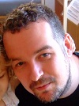
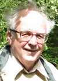
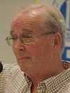
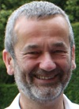
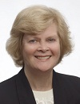
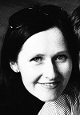
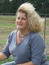
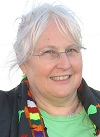

**Whether you are a descendant of the people on this site, or an unrelated but interested family researcher, it'd be nice to add you to this page. Do please contact me: Dave Barton, by [email](mailto:dbhbarton+history1@googlemail.com).**

Obviously one shouldn't share too much personal information on the internet, but I believe the level of detail I've provided in my own mini-biography below is quite safe.

---

# Dr. David B. H. Barton

The creator of this website. Son of Nicholas J. Barton ([below](Living%20connections.md#Nicholas%20Barton)). I live in [Leicester, UK](https://maps.google.co.uk/maps?q=Leicester,+UK&ie=UTF8&hq=&hnear=Leicester,+United+Kingdom&gl=uk&ei=Ew4BTZbEFpK1hAfjoe3sBw&oi=geocode_result&ved=0CCoQ8gEwAA&ll=52.63477,-1.129519&spn=1.840227,4.938354&z=8). I'm a geneticist working at the University of Leicester and a parent of two. I don't have a lot of free time to work on this site these days.

---

# Nicholas J. Barton

Son of [Ronald Barton (1901-1986)](Ronald%20Barton%20%281901-1986%29.md). Became a Fellow of the Royal College of Surgeons in ~1965. Was president of the British Society for Surgery of the Hand in 1988, editor of the Journal of Hand Surgery, British Volume (1987-1991), and chairman of the Royal Colleges of Surgery Specialist Advisory Committee on Orthopaedics (1994-1995). He is now retired and lives in [Gloucestershire, UK](https://maps.google.co.uk/maps?q=gloucestershire&ie=UTF8&hq=&hnear=Gloucestershire,+United+Kingdom&gl=uk&z=9). A keen historian, he is the author of '[The Lost Rivers of London (1962)](http://www.amazon.co.uk/Lost-Rivers-London-Effects-Londoners/dp/094866715X)', and is responsible for a great deal of the [family history research](_NJB%20family%20archive.md) that appears on this site.

---

# Malcolm D. Barton

A grandson of [Rev. Jack Barton (1866-1941)](Rev.%20Jack%20Barton%20%281866-1941%29.md). Malcolm lives in [Bath, UK](https://maps.google.co.uk/maps?f=q&source=s_q&hl=en&geocode=&q=Bath,+UK&sll=52.63477,-1.129519&sspn=1.840227,4.938354&gl=uk&ie=UTF8&hq=&hnear=Bath,+United+Kingdom&ll=51.382067,-2.356567&spn=0.946249,2.469177&z=9). He was a history teacher and for 12 years the headmaster of a preparatory school, but is now retired.

---

\
**Andrew G. Beamish**\
\
Andrew is a grandson of [Isabel Mary Young (1870-1929)](Isabel%20Mary%20Young%20%281870-1929%29.md), and great-grandson of [Isabel Maria Elliott (1842-1870)](Isabel%20Maria%20Elliott%20%281842-1870%29.md). He also knew third cousin [Nick Barton](Living%20connections.md#Nicholas%20Barton) when they were both growing up in Hampstead Garden Suburb pre-war. Andrew became an actuary and emigrated to Canada, where he is retired, living in [Waterloo, Ontario](https://maps.google.co.uk/maps?q=waterloo,+ontario&ie=UTF8&hq=&hnear=Waterloo,+Waterloo+Regional+Municipality,+Ontario,+Canada&gl=uk&ll=43.480826,-80.535278&spn=2.200184,4.938354&z=8), and enjoys dabbling in family tree stuff. He is one of the editors of this site.

---

# Charles Baron

\
Charles is a great-great-grandson of [Rev. Charles Boileau Elliott (1803-1875)](Rev.%20Charles%20Boileau%20Elliott%20%281803-1875%29.md), great-grandson of [Emily](Emily%20Elliott%20%281839-1924%29.md)'s brother [Charles Pearson Elliott (1833-1876)](Charles%20Pearson%20Elliott%20%281833-1876%29.md) and grandson of [William Robert Elliott (b.1871)](William%20Robert%20Elliott%20%28b.1871%29.md) (Bob), a keen amateur genealogist from whom Charles has inherited an interest in his family history. Charles' mother Gwendoline Lister Edith Baron (Née Elliott) is still going strong at the age of 99 (in 2012). Charles lives in North Wales and is still working full time as a medical practitioner.

Contact him through his membership page [here](http://www.wikispaces.com/user/view/charlesbaron).

---

# Iola Mathews

\
Iola (née Hack) lives in [Melbourne, Australia](https://maps.google.co.uk/maps?q=melbourne&ie=UTF8&hq=&hnear=Melbourne+Victoria,+Australia&gl=uk&ll=-37.892196,143.10791&spn=8.823696,19.753418&z=6), and is a great-great-great granddaughter of the writer [Maria Hack (1777-1844)](Maria%20Hack%20%281777-1844%29.md). Iola is a journalist and [[@<http://www.amazon.co.uk/s/ref=ntt_athr_dp_sr_1?_encoding=UTF8&search-alias=books-uk&field-author=Iola> Mathews|author]] and is currently writing a biography of her great-great grandfather John Barton Hack (1805-1884) who was a pioneer in South Australia.

---

# Sarah Bailey

\
Sarah lives in [Adelaide, Australia](https://maps.google.co.uk/maps?q=Adelaide&ll=-34.921971,138.603516&spn=18.192522,39.506836&gl=uk&z=5) and is a great-great-great-great-great granddaughter of [Maria Hack (1777-1844)](Maria%20Hack%20%281777-1844%29.md). Sarah is a Library Assistant, part time student in Library Studies and occasional TV Extra. She has an 8 year old son and enjoys travelling and researching family history in her spare time.

---

# Laurel Rockliff

Laurel (née Butler) lives in [Blenheim, New Zealand](https://maps.google.co.uk/maps?q=Blenheim,+New+Zealand&ie=UTF8&hq=&hnear=Blenheim,+Marlborough,+New+Zealand&gl=uk&ll=-41.516804,173.963013&spn=2.093593,4.938354&z=8) and is a great-great-great-granddaughter of [John Dougan](John%20Dougan%20%281765-1826%29.md) through his eldest daughter [Mary Stephen Dougan (1804-1881)](Mary%20Stephen%20Dougan%20%281804-1881%29.md), who emigrated to Australia with her family on the first Australian voyage of Brunel's [S.S. Great Britain](http://en.wikipedia.org/wiki/SS_Great_Britain) in 1852. Amazingly, Laurel is *also* descended from Broadbents; her Broadbent ancestors (also Methodists and farmers/mill workers) coming from the [Padfield](https://maps.google.co.uk/maps?f=q&source=s_q&hl=en&geocode=&q=padfield&aq=&sll=50.739932,-3.999023&sspn=0.029983,0.077162&gl=uk&ie=UTF8&hq=&hnear=Padfield,+Glossop,+Derbyshire,+United+Kingdom&ll=53.463423,-1.955738&spn=0.056412,0.154324&z=13) area, only ~14 miles SSW of the [Longwood Edge Broadbents](_Broadbent%201976.md).\
.

---

# Jenny Hardy

Jenny is a descendant of [Charles Boileau (d.1733)](Charles%20Boileau%20%28d.1733%29.md), through his daughter Marie Boileau and her husband Henry Bartholemey Hardy. She was born in [Redruth](http://en.wikipedia.org/wiki/Redruth), raised on the [Isles of Scilly](http://en.wikipedia.org/wiki/Isles_of_Scilly) and now lives in [Kingswinford, UK](https://maps.google.co.uk/maps?q=Kingswinford&ie=UTF8&hq=&hnear=Kingswinford,+Dudley,+United+Kingdom&gl=uk&ll=52.496996,-2.172546&spn=0.211524,0.617294&z=11). She has a son and two brothers living in Australia.

---

# Tina Woodhead

Tina's children are also descendants (great-great-great-grandchildren) of [Mary Stephen Dougan (1804-1881)](Mary%20Stephen%20Dougan%20%281804-1881%29.md). Though Tina herself is not related, she has done extensive research on the Dougan line and related families, in particular the Walkden family, into which Mary married. She is making her research publicly available on her own Wiki at [http://walkdenfamily.wikispaces.com/](http://walkdenfamily.wikispaces.com/home). She lives in [Oatlands, Sydney, Australia](https://maps.google.co.uk/maps?f=q&source=s_q&hl=en&geocode=&q=Oatlands,+Sydney,+Australia&aq=&sll=-33.804113,151.041241&sspn=0.079166,0.154324&gl=uk&ie=UTF8&hq=&hnear=Oatlands+New+South+Wales,+Australia&ll=-33.796838,151.02562&spn=0.158345,0.308647&z=12).
