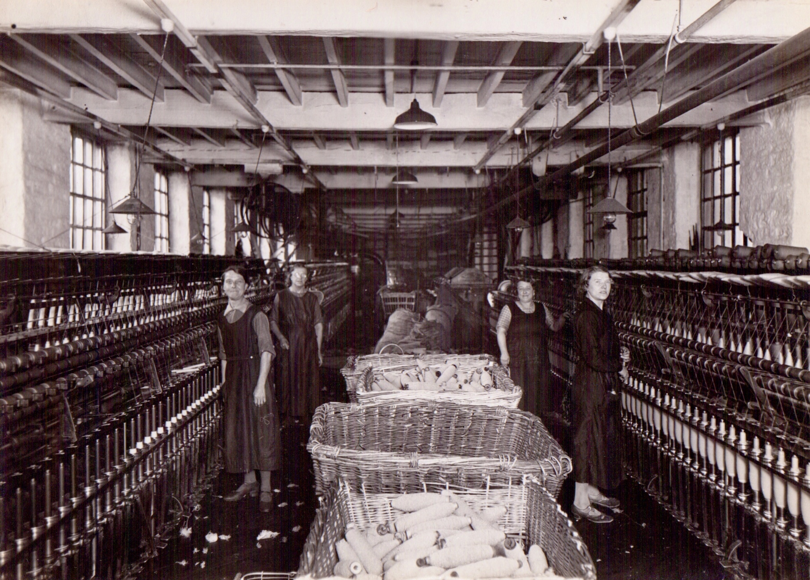
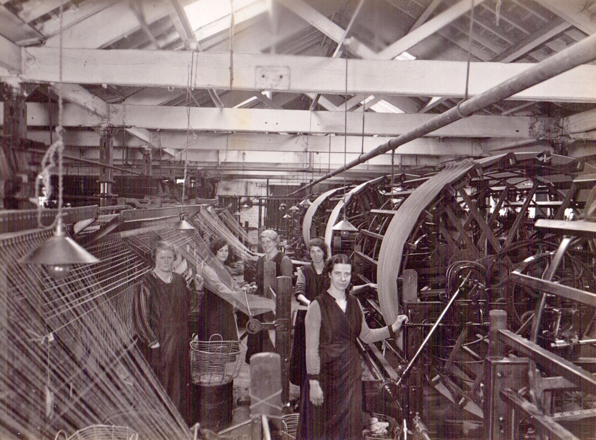

[[Embedded Bing map]](http://www.bing.com/maps/embed/?lvl=14&cp=53.647046262323286~-1.8351738443915933&sty=s&draggable=true&v=2&dir=0&form=LMLTEW&mkt=en-gb&emid=df05b67c-11a1-87e3-d33e-375218d6794c&w=800&h=400)

[View Larger Map](http://www.bing.com/maps/?cp=53.647046262323286~-1.8351738443915933&sty=s&lvl=14&where1=&mm_embed=map&form=LMLTEW) [Get Directions](http://www.bing.com/maps/?cp=53.647046262323286~-1.8351738443915933&sty=s&lvl=14&rtp=~pos.53.647046262323286_-1.8351738443915933_&mm_embed=dir&form=LMLTEW) [View Bird's Eye](http://www.bing.com/maps/?cp=sy71q7gvdbvr&sty=b&lvl=18&where1=&mm_embed=be&form=LMLTEW)

[[Embedded MapChannels map]](http://data.mapchannels.com/streetmap/v101/streetmap101.htm?x=-1.843466&y=53.647937&z=16&t=0&c=1&s=0&b=287&p=-14&m=0&j=1&k=1&v=1)

Parkwood Mills today (Google StreetView imagery presented though [http://www.streetcities.com](http://www.streetcities.com/))

From [\*Broadbent 1976](_Broadbent%201976.md):\
*The origin of the Parkwood Mills, as the Broadbent mills have always been known, is that some time in the 1830's the family acquired "Butcher's Mill" in payment of a bad debt. This was a small square mill, driven by a waterwheel, the pit for which still exists. It is now known as No. 1 Mill, but when my cousin "young" Theo first joined the company it was still referred to as Butcher's Mill by some of the older inhabitants.*

*Nos. 2 and 3 Mills were built later in the century, and all were equipped in due course with two horizontal steam engines, one of which replaced the waterwheel. Both these engines were still running in my youth, one alleged to be eighty years old, though I think this must have been an exaggeration. The larger and more recent was a magnificent piece of Victorian engineering. It had two cylinders with enormous piston-rods yearly twenty feet long, and the non-moving parts were painted green and gold. Its power turned a vast wheel on which was a roperace. Manila ropes about two inches thick ran upwards to all floors of the building, where the power was transferred to belt-drives which ran the looms, spinning-machines and other equipment. To my young mind it gave an impression of illimitable strength, as it purred away with very little sound. Today the Mills are run by electricity.*

*There were many ancillary buildings, including a dyehouse which existed from the earliest times. In my time there were buildings on each side of the road, connected by a pedestrian bridge. The main ones south of the road were occupied by the Broadbent companies and included their offices, while the single building to the north was let, floor by floor, to tenants. More is said later about the developments in the Mills, particularly in the life of Butterworth.*

*The Broadbents were good employers, and there has been a remarkable absence of industrial unrest or strikes, even to the present day. A few strikes there have been, one as far back as 1896 which caused the family great anxiety, but they have been common to the whole industry.*

*In general, management of the Mills was a humdrum affair, though the state of trade was often a cause of worry, and in the early days there were times when there was hardly enough money to pay the staff and the coal bill. Accidents did however happen. There was once a serious smash of one of the engines, which did great damage, and a letter to John in India describes another, which took place on 27 January 1879:*

*"We had just finished (midday) dinner when Robert came running up to say that there had been an accident with the crane and John Haigh was badly hurt. Ben ran off at once with brandy and cottonwool, and while Dr. Haigh bound up the wounds Charles drove Dr. Walker to Huddersfield to have all ready at the Infirmary. It was evident his leg must be amputated, it was so frightfully crushed, but we thought that would be the worst, but when Ben arrived at 8... he was told that he had died 5 minutes before. Poor Ben, it has been a terrible blow to him. We all went to the funeral. It was a terribly cold day, and the snow was nearly a yard thick at the top of the hill." John replied: "...I have felt John Haigh's death very much. There are few men in any station in life for whom I cared so much; he was so true and loyal..."*

*There were also a least two fires. Arthur gives a graphic description of one, on June 1, 1875. "We were all waked up by the buzzer at 4½ (4.30 am), Ben and I rushed down to the Mills, which were almost hid with clouds of smoke and steam. As we got nearer we were tremendously relieved to see the flames proceeded from a drying-store, which is separated from the large mill by the engine-house and is fireproof. We have a good Fire Brigade, and when we got down the hose was out and ready for playing. As soon as we got the water turned on such a deluge was poured on the fire that it was mastered in quarter of an hour. I got drenched to the skin within a few minutes and was also somewhat scorched."*

*The following is a list of Broadbents who have occupied a managerial position in the Mills, with their approximate dates. Some have been partners, others managing directors or directors, according to the structure of the companies at the time. It will be noted that there is a great deal of overlapping. Also, in recent times there have been and are many directors who are not members of the family.*

*c.1825 - c.1875 [John Broadbent II](John%20Broadbent%20%281796-1880%29.md)*\
*c.1855 - 1873 [Butterworth](Butterworth%20Broadbent%20%281837-1873%29.md)*\
*1873 - 1930 Arthur*\
*1875 - 1925 Benjamin*\
*c.1886 - 1895 Arnold*\
*c.1923 - 1952 [Colonel Theo](Col.%20Theodore%20Broadbent%20%281881-1952%29.md) (my father)*\
*c.1920 - 1938 Benedict*\
*c. 1950 Theo*

The pictures below, thought to date from the late 1920s, were provided by Roger Broadbent (grandson of the author of the above) and are published here with his permission:

\
[J.T.C. Broadbent](Col.%20Theodore%20Broadbent%20%281881-1952%29.md) & W.K.B. Broadbent, ~1929?

\
General Office

\
Engine House

\
Teasing department

\
Scribbling department

\
Spinning department

\
Twisting

\
Warping

\
Weaving shed
