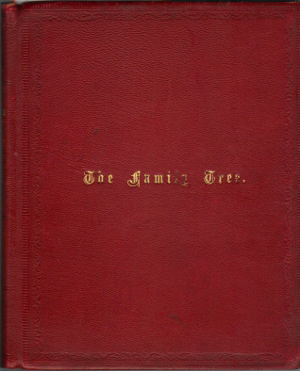

This unpublished handwritten notebook, with the words 'The Family Tree' embossed on the red leather cover, contains family trees, names and dates for a large number of Bartons, Elliotts and associated families. Most of it is written in the same handwriting, but there are additions in various other hands.

\
In the opening pages is an index in which [Rev. John Barton of Cambridge (1836-1908)](Rev.%20John%20Barton%20of%20Cambridge%20%281836-1908%29.md) is listed as 'Father', and his father 'Grandfather' etc, showing that the book was created by one of the Rev. John Barton of Cambridge's children.

On p49 there is one note, seemingly in the primary handwriting, which is initialled AEB, suggesting that the primary author was [Arthur Elliott Barton (1864-1931)](Arthur%20Elliott%20Barton%20%281864-1931%29.md), eldest son of [Rev. John Barton](Rev.%20John%20Barton%20of%20Cambridge%20%281836-1908%29.md) and [Emily Elliott (1839-1924)](Emily%20Elliott%20%281839-1924%29.md). The latest date written in AEB's handwriting is 10 January 1901 - the birth of [Ronald Barton (1901-1986)](Ronald%20Barton%20%281901-1986%29.md), but his name is left blank, suggesting that this was the approximate date at which the original author stopped writing it.

The details in this book have proven to be very reliable, and it gives many dates that have not been found elsewhere.
